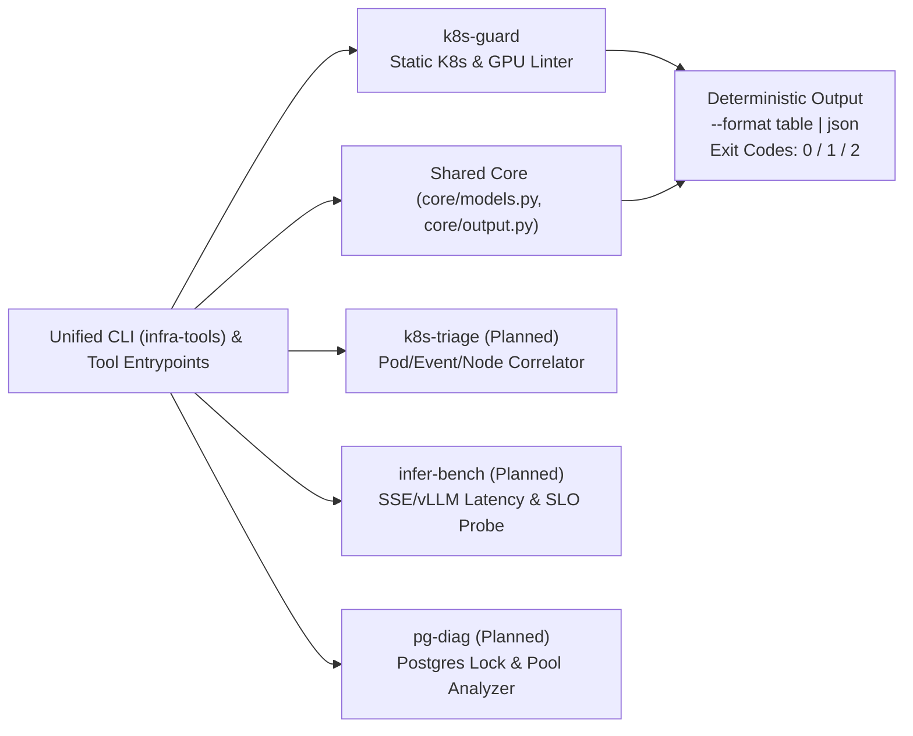

# infrastructure-tools

A single Python package containing four focused, locally testable CLI utilities for Kubernetes reliability, data-infrastructure diagnostics, and AI-inference verification.

## Architecture



## Four-Tool Roadmap

| Tool | Domain | Status | Purpose |
| --- | --- | --- | --- |
| `k8s-guard` | Platform / SRE / ML Platform | **Complete** | Static reliability, security, and GPU-hygiene linter for YAML manifests and `helm template` output |
| `k8s-triage` | SRE / Platform / AI Infra | Planned | Correlates unhealthy pods, events, probe failures, and node pressure with offline `--fixture` replay |
| `infer-bench` | AI Infra / AI Reliability | Planned | Async SSE streaming benchmark measuring TTFT, ITL, tok/s, error rates, and SLO gates for OpenAI/vLLM APIs |
| `pg-diag` | SRE / Data Infra | Planned | Read-only PostgreSQL analyzer for blocking lock chains, connection saturation, and idle-in-transaction leaks |

---

## Tool 1: `k8s-guard`

### Problem

Kubernetes reliability incidents frequently stem from preventable manifest regressions: mutable `:latest` images, unbounded memory/CPU containers, missing readiness/liveness probes, multi-replica Deployments without a `PodDisruptionBudget`, privileged containers, or GPU workloads missing matching `nvidia.com/gpu` requests/limits and node tolerations. Catching these only after rollout wastes on-call time and degrades cluster stability.

### Use Case

Run `k8s-guard` locally, in pre-commit hooks, or in CI/CD pipelines against raw Kubernetes YAML files, manifest directories, or rendered Helm charts (`helm template ... | k8s-guard scan -`) to enforce deterministic reliability, security, and GPU-hygiene guardrails before deployment.

### Rules

| Rule ID | Severity | Check |
| --- | --- | --- |
| `KG001` | `HIGH` | Unpinned container or initContainer image (`:latest` or missing tag/digest) |
| `KG002` | `HIGH` | Missing CPU or memory `requests` or `limits` on container/initContainer |
| `KG003` | `MEDIUM` | Missing `readinessProbe` on `Deployment`/`StatefulSet` container |
| `KG004` | `MEDIUM` | Missing `livenessProbe` on `Deployment`/`StatefulSet` container |
| `KG005` | `CRITICAL` / `HIGH` | `privileged: true` (`CRITICAL`) or missing `runAsNonRoot: true`, `allowPrivilegeEscalation: false`, or `capabilities.drop: [ALL]` (`HIGH`) |
| `KG006` | `MEDIUM` | `Deployment`/`StatefulSet` with `replicas > 1` lacking a namespace- and selector-matched `PodDisruptionBudget` |
| `KG007` | `HIGH` / `MEDIUM` | GPU hygiene: `nvidia.com/gpu` `requests == limits` and `> 0` (`HIGH`); missing GPU `tolerations` or `nodeSelector`/`affinity.nodeAffinity` (`MEDIUM`) |
| `KG008` | `LOW` | `Deployment` with `replicas > 1` missing `readOnlyRootFilesystem: true` |

### Installation

Requires Python 3.11+ and [`uv`](https://docs.astral.sh/uv/).

```bash
uv sync --extra dev
```

### Usage

```bash
# Scan a single manifest file (Rich table output)
uv run k8s-guard scan tests/fixtures/k8s_guard/hardened_deployment.yaml

# Scan a directory of manifests with JSON output for CI
uv run k8s-guard scan ./k8s/manifests --format json --fail-on high

# Pipe rendered Helm manifests via stdin
helm template my-release ./charts/my-app | uv run k8s-guard scan -

# Suppress specific rules (repeatable or comma-separated)
uv run k8s-guard scan ./deploy.yaml --ignore KG008 --ignore KG004

# List built-in rules
uv run k8s-guard rules

# Unified dispatcher entrypoint
uv run infra-tools k8s-guard scan tests/fixtures/k8s_guard/hardened_deployment.yaml
```

### Example Output (`--format json`)

```json
{
  "tool": "k8s-guard",
  "target": "tests/fixtures/k8s_guard/gpu_workload_broken.yaml",
  "summary": {
    "documents_scanned": 1,
    "total_findings": 2,
    "by_severity": {
      "CRITICAL": 0,
      "HIGH": 1,
      "MEDIUM": 1,
      "LOW": 0,
      "INFO": 0
    }
  },
  "findings": [
    {
      "rule_id": "KG007",
      "severity": "HIGH",
      "resource": "Deployment/ml-serving/vllm-inference",
      "location": "tests/fixtures/k8s_guard/gpu_workload_broken.yaml:22",
      "message": "container 'vllm' has invalid GPU allocation: requests (1) != limits (2).",
      "remediation": "Set equal, positive integer values for both resources.requests['nvidia.com/gpu'] and resources.limits['nvidia.com/gpu']."
    },
    {
      "rule_id": "KG007",
      "severity": "MEDIUM",
      "resource": "Deployment/ml-serving/vllm-inference",
      "location": "tests/fixtures/k8s_guard/gpu_workload_broken.yaml:16",
      "message": "GPU workload lacks explicit GPU scheduling constraints: missing tolerations, nodeSelector or affinity.nodeAffinity.",
      "remediation": "Add GPU node tolerations (e.g., nvidia.com/gpu:NoSchedule) and a nodeSelector or affinity.nodeAffinity targeting GPU nodes."
    }
  ],
  "passed": false
}
```

### Exit Codes

| Code | Meaning |
| --- | --- |
| `0` | Scan completed and no findings met or exceeded `--fail-on` |
| `1` | One or more findings met or exceeded `--fail-on` |
| `2` | Input, filesystem, YAML parse, or CLI argument error |

### Error Handling

- Missing files, empty manifest directories, malformed YAML, non-mapping YAML documents, and unknown `--ignore` rule IDs emit a structured error message to `stderr` and exit with code `2` (never a raw Python traceback).
- All YAML parsing uses `yaml.SafeLoader` exclusively.

### Tests & Verification

```bash
uv run ruff check .
uv run mypy src
uv run pytest -v
```

### Known Limitations

- Static analysis operates only on the scanned manifest set: if a `PodDisruptionBudget` lives in a separate repository or cluster-wide chart not passed to `k8s-guard`, `KG006` will report it as missing unless scanned together or suppressed with `--ignore KG006`.
- Custom Resource Definitions (CRDs) such as Argo Rollouts or RayService are not parsed as built-in pod controllers yet.
- `KG007` checks `nvidia.com/gpu` specifically and does not yet validate AMD (`amd.com/gpu`) or MIG resource profiles.

### Production Considerations

- Run `k8s-guard scan - --format json` after `helm template` or `kustomize build` so post-overlay labels, `replicas`, and PDB selectors are evaluated accurately.
- Start with `--fail-on high` in brownfield repositories and tighten to `--fail-on medium` or `--fail-on low` once legacy workloads are remediated.
- Pair static pre-merge guardrails (`k8s-guard`) with cluster admission control (e.g., Pod Security Admission / Kyverno) for defense in depth.
