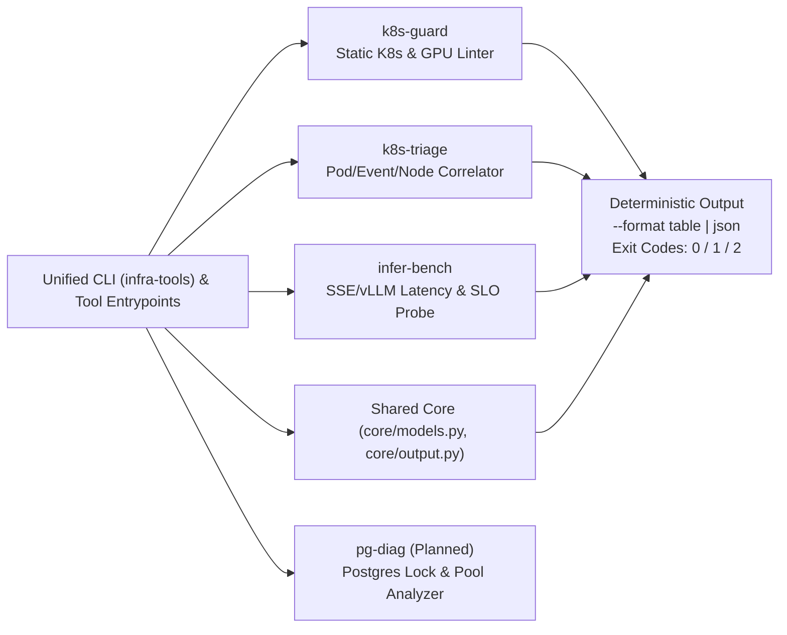

# infrastructure-tools

A single Python package containing four focused, locally testable CLI utilities for Kubernetes reliability, data-infrastructure diagnostics, and AI-inference verification.

## Architecture



## Four-Tool Roadmap

| Tool | Domain | Status | Purpose |
| --- | --- | --- | --- |
| `k8s-guard` | Platform / SRE / ML Platform | **Complete** | Static reliability, security, and GPU-hygiene linter for YAML manifests and `helm template` output |
| `k8s-triage` | SRE / Platform / AI Infra | **Complete** | Correlates unhealthy pods, events, probe failures, and node pressure with offline `--fixture` replay |
| `infer-bench` | AI Infra / AI Reliability | **Complete** | Async SSE streaming benchmark measuring TTFT, ITL, tok/s, error rates, and SLO gates for OpenAI/vLLM APIs |
| `pg-diag` | SRE / Data Infra | Planned | Read-only PostgreSQL analyzer for blocking lock chains, connection saturation, and idle-in-transaction leaks |

---

## Tool 1: `k8s-guard`

### Problem

Kubernetes reliability incidents frequently stem from preventable manifest regressions: mutable `:latest` images, unbounded memory/CPU containers, missing readiness/liveness probes, multi-replica Deployments without a `PodDisruptionBudget`, privileged containers, or GPU workloads missing matching `nvidia.com/gpu` requests/limits and node tolerations. Catching these only after rollout wastes on-call time and degrades cluster stability.

### Use Case

Run `k8s-guard` locally, in pre-commit hooks, or in CI/CD pipelines against raw Kubernetes YAML files, manifest directories, or rendered Helm charts (`helm template ... | k8s-guard scan -`) to enforce deterministic reliability, security, and GPU-hygiene guardrails before deployment.

### Rules

| Rule ID | Severity | Check |
| --- | --- | --- |
| `KG001` | `HIGH` | Unpinned container or initContainer image (`:latest` or missing tag/digest) |
| `KG002` | `HIGH` | Missing CPU or memory `requests` or `limits` on container/initContainer |
| `KG003` | `MEDIUM` | Missing `readinessProbe` on `Deployment`/`StatefulSet` container |
| `KG004` | `MEDIUM` | Missing `livenessProbe` on `Deployment`/`StatefulSet` container |
| `KG005` | `CRITICAL` / `HIGH` | `privileged: true` (`CRITICAL`) or missing `runAsNonRoot: true`, `allowPrivilegeEscalation: false`, or `capabilities.drop: [ALL]` (`HIGH`) |
| `KG006` | `MEDIUM` | `Deployment`/`StatefulSet` with effective min replicas `> 1` (`max(spec.replicas or 1, autoscaling/v2 HPA minReplicas)`) lacking a namespace- and selector-matched `PodDisruptionBudget` |
| `KG007` | `HIGH` / `MEDIUM` | GPU hygiene: `nvidia.com/gpu` `requests == limits` and `> 0` (`HIGH`); missing GPU `tolerations` or `nodeSelector`/`affinity.nodeAffinity` (`MEDIUM`) |
| `KG008` | `LOW` | Non-init container on any pod workload missing `securityContext.readOnlyRootFilesystem: true` |

### Installation

Requires Python 3.11+ and [`uv`](https://docs.astral.sh/uv/).

```bash
uv sync --extra dev
```

### Usage

```bash
# Scan a single manifest file (readable non-truncating text blocks)
uv run k8s-guard scan tests/fixtures/k8s_guard/hardened_deployment.yaml

# Scan a directory of manifests with JSON output for CI
uv run k8s-guard scan ./k8s/manifests --format json --fail-on high

# Pipe rendered Helm manifests via stdin
helm template my-release ./charts/my-app | uv run k8s-guard scan -

# Suppress specific rules (repeatable or comma-separated)
uv run k8s-guard scan ./deploy.yaml --ignore KG008 --ignore KG004

# List built-in rules
uv run k8s-guard rules

# Unified dispatcher entrypoint
uv run infra-tools k8s-guard scan tests/fixtures/k8s_guard/hardened_deployment.yaml
```

### Example Output (`--format table`, `COLUMNS=80`)

```text
k8s-guard target=tests/fixtures/k8s_guard/broken_workload.yaml scanned=1 
findings=8 status=FAIL

CRITICAL  KG005  Deployment/default/web-frontend
  location: tests/fixtures/k8s_guard/broken_workload.yaml:20
  message:  container 'web' runs with securityContext.privileged=true.
  fix:      Remove privileged: true and grant only minimal required 
capabilities.

HIGH      KG001  Deployment/default/web-frontend
  location: tests/fixtures/k8s_guard/broken_workload.yaml:18
  message:  container 'web' uses unpinned image 'nginx:latest'.
  fix:      Pin image to an immutable version tag or '@sha256:...' digest.

HIGH      KG002  Deployment/default/web-frontend
  location: tests/fixtures/k8s_guard/broken_workload.yaml:17
  message:  container 'web' is missing resource constraints: requests.cpu, 
requests.memory, limits.cpu, limits.memory.
  fix:      Set explicit cpu and memory values under resources.requests and 
resources.limits.

HIGH      KG005  Deployment/default/web-frontend
  location: tests/fixtures/k8s_guard/broken_workload.yaml:20
  message:  container 'web' is missing securityContext hardening: runAsNonRoot: 
true, allowPrivilegeEscalation: false, capabilities.drop: [ALL].
  fix:      Set runAsNonRoot: true, allowPrivilegeEscalation: false, and 
capabilities.drop: [ALL].

MEDIUM    KG003  Deployment/default/web-frontend
  location: tests/fixtures/k8s_guard/broken_workload.yaml:17
  message:  container 'web' is missing a readinessProbe.
  fix:      Configure a readinessProbe so traffic is only routed to ready pods.

MEDIUM    KG004  Deployment/default/web-frontend
  location: tests/fixtures/k8s_guard/broken_workload.yaml:17
  message:  container 'web' is missing a livenessProbe.
  fix:      Configure a livenessProbe so deadlocked containers are restarted.

MEDIUM    KG006  Deployment/default/web-frontend
  location: tests/fixtures/k8s_guard/broken_workload.yaml:7
  message:  Deployment with replicas=3 has no matching PodDisruptionBudget in 
scanned manifests.
  fix:      Define a PodDisruptionBudget in the same namespace with a selector 
matching the workload pod template labels.

LOW       KG008  Deployment/default/web-frontend
  location: tests/fixtures/k8s_guard/broken_workload.yaml:20
  message:  container 'web' is missing readOnlyRootFilesystem: true.
  fix:      Set securityContext.readOnlyRootFilesystem: true and mount emptyDir 
volumes for writable scratch paths.

Summary: CRITICAL=1  HIGH=3  MEDIUM=3  LOW=1
```

### Example Output (`--format json`)

```json
{
  "tool": "k8s-guard",
  "target": "tests/fixtures/k8s_guard/gpu_workload_broken.yaml",
  "summary": {
    "documents_scanned": 1,
    "total_findings": 2,
    "by_severity": {
      "CRITICAL": 0,
      "HIGH": 1,
      "MEDIUM": 1,
      "LOW": 0,
      "INFO": 0
    }
  },
  "findings": [
    {
      "rule_id": "KG007",
      "severity": "HIGH",
      "resource": "Deployment/ml-serving/vllm-inference",
      "location": "tests/fixtures/k8s_guard/gpu_workload_broken.yaml:22",
      "message": "container 'vllm' has invalid GPU allocation: requests (1) != limits (2).",
      "remediation": "Set equal, positive integer values for both resources.requests['nvidia.com/gpu'] and resources.limits['nvidia.com/gpu']."
    },
    {
      "rule_id": "KG007",
      "severity": "MEDIUM",
      "resource": "Deployment/ml-serving/vllm-inference",
      "location": "tests/fixtures/k8s_guard/gpu_workload_broken.yaml:16",
      "message": "GPU workload lacks explicit GPU scheduling constraints: missing tolerations, nodeSelector or affinity.nodeAffinity.",
      "remediation": "Add GPU node tolerations (e.g., nvidia.com/gpu:NoSchedule) and a nodeSelector or affinity.nodeAffinity targeting GPU nodes."
    }
  ],
  "passed": false
}
```

### Exit Codes

| Code | Meaning |
| --- | --- |
| `0` | Scan completed and no findings met or exceeded `--fail-on` |
| `1` | One or more findings met or exceeded `--fail-on` |
| `2` | Input, filesystem, YAML parse, or CLI argument error |

### Error Handling

- Missing files, empty manifest directories, malformed YAML, non-mapping YAML documents, and unknown `--ignore` rule IDs emit a structured error message to `stderr` and exit with code `2` (never a raw Python traceback).
- All YAML parsing uses `yaml.SafeLoader` exclusively.

### Tests & Verification

```bash
uv run ruff check .
uv run mypy src
uv run pytest -v
```

### Known Limitations

- Static analysis operates only on the scanned manifest set: if a `PodDisruptionBudget` lives in a separate repository or cluster-wide chart not passed to `k8s-guard`, `KG006` will report it as missing unless scanned together or suppressed with `--ignore KG006`.
- Custom Resource Definitions (CRDs) such as Argo Rollouts or RayService are not parsed as built-in pod controllers yet.
- `KG007` checks `nvidia.com/gpu` specifically and does not yet validate AMD (`amd.com/gpu`) or MIG resource profiles.

### Production Considerations

- Run `k8s-guard scan - --format json` after `helm template` or `kustomize build` so post-overlay labels, `replicas`, and PDB selectors are evaluated accurately.
- Start with `--fail-on high` in brownfield repositories and tighten to `--fail-on medium` or `--fail-on low` once legacy workloads are remediated.
- Pair static pre-merge guardrails (`k8s-guard`) with cluster admission control (e.g., Pod Security Admission / Kyverno) for defense in depth.

---

## Tool 2: `k8s-triage`

### Problem

During Kubernetes incidents, root-cause evidence is fragmented across pod statuses, container `lastState` termination codes, namespace `Events`, and `Node` pressure conditions. Running `kubectl get pods`, `describe pod`, `get events`, and `get nodes` manually across namespaces slows triage and makes it easy to miss silent restart loops or node-wide pressure affecting multiple workloads.

### Use Case

Run `k8s-triage` read-only against a live Kubernetes cluster (with bounded API timeouts) or offline against a captured `ClusterSnapshot` JSON fixture (`--fixture`) to produce severity-ranked root-cause findings and concrete remediation steps in table or JSON format. Both live collection and fixture replay feed the exact same pure analyzer.

### Rules

| Rule ID | Severity | Check |
| --- | --- | --- |
| `KT001` | `CRITICAL` | Container `OOMKilled` (`reason == OOMKilled` or exit code `137`) correlated with pod events, declared memory limits, and CrashLoopBackOff/restart state (supersedes `KT002` and `KT008` for the same container) |
| `KT002` | `HIGH` | Non-OOM `CrashLoopBackOff` with restart count, last termination reason/exit code, and correlated warning events (supersedes `KT008` for the same container) |
| `KT003` | `HIGH` | `ImagePullBackOff` / `ErrImagePull` with failing image reference and correlated pull error event |
| `KT004` | `HIGH` | `CreateContainerConfigError` / `CreateContainerError` (missing ConfigMap/Secret or runtime constraint) |
| `KT005` | `HIGH` | Unschedulable `Pending` pod (`PodScheduled=False` / `FailedScheduling`), distinguishing GPU/CPU/memory insufficiency vs taint/affinity mismatch |
| `KT006` | `MEDIUM` | Failing readiness/liveness/startup probe (`Unhealthy` warning events) with event count and latest failure message |
| `KT007` | `CRITICAL` / `HIGH` | Unhealthy `Node` (`Ready != True` -> `CRITICAL`; `MemoryPressure`/`DiskPressure`/`PIDPressure` -> `HIGH`), listing scheduled pods on the node |
| `KT008` | `MEDIUM` | High container restart count (`>= 3`) not already covered by `KT001`/`KT002` (such as currently `Running` containers) to catch silent instability |

### Usage

```bash
# Inspect a live cluster namespace (read-only CoreV1Api, 10s request timeout)
uv run k8s-triage inspect --namespace ml-serving

# Inspect all namespaces using a specific kubeconfig context
uv run k8s-triage inspect --all-namespaces --context kind-dev --format json

# Analyze an offline ClusterSnapshot fixture (no cluster required)
uv run k8s-triage inspect --fixture tests/fixtures/k8s_triage/unschedulable_gpu_and_probe.json --format json

# Enforce CI/post-deploy gate on CRITICAL findings only
uv run k8s-triage inspect --fixture tests/fixtures/k8s_triage/oom_and_crashloop.json --fail-on critical

# List built-in diagnostic rules
uv run k8s-triage rules

# Unified dispatcher entrypoint
uv run infra-tools k8s-triage inspect --fixture tests/fixtures/k8s_triage/healthy_cluster.json
```

### Example Output (`--format table`, `COLUMNS=80`)

```text
k8s-triage target=tests/fixtures/k8s_triage/oom_and_crashloop.json scanned=3 
findings=2 status=FAIL

CRITICAL  KT001  Pod/ml-serving/embedding-worker-7c9d4f8b2-x9k2p
  location: container/worker
  message:  Container 'worker' was OOMKilled (also in CrashLoopBackOff, 
restarts=6, memory limit=512Mi). Event: BackOff - Back-off restarting failed 
container worker in pod embedding-worker-7c9d4f8b2-x9k2p
  fix:      Profile container memory usage for leaks, raise 
resources.limits.memory, and align runtime heap/KV-cache ceilings with the 
cgroup limit.

MEDIUM    KT008  Pod/production/cache-proxy-9b4a2f1d-m3q1z
  location: container/proxy
  message:  Container 'proxy' has 4 restarts (current state=running, 
last_reason=Error).
  fix:      Investigate recurring container restarts even if currently Running 
to eliminate silent crash loops or liveness-probe flaps.

Summary: CRITICAL=1  MEDIUM=1
```

### Example Output (`--format json`)

```json
{
  "tool": "k8s-triage",
  "target": "tests/fixtures/k8s_triage/unschedulable_gpu_and_probe.json",
  "summary": {
    "documents_scanned": 4,
    "total_findings": 3,
    "by_severity": {
      "CRITICAL": 0,
      "HIGH": 2,
      "MEDIUM": 1,
      "LOW": 0,
      "INFO": 0
    }
  },
  "findings": [
    {
      "rule_id": "KT003",
      "severity": "HIGH",
      "resource": "Pod/staging/model-loader-4f1a9c-q7w2e",
      "location": "container/loader",
      "message": "Container 'loader' failed to pull image 'ghcr.io/example-org/model-loader:9.9.9' (ImagePullBackOff). Detail: Failed to pull image \"ghcr.io/example-org/model-loader:9.9.9\": rpc error: code = NotFound desc = manifest unknown",
      "remediation": "Verify image name and tag exist in the registry, confirm imagePullSecrets credentials, and check cluster egress to the registry."
    },
    {
      "rule_id": "KT005",
      "severity": "HIGH",
      "resource": "Pod/ml-serving/vllm-llama-0",
      "location": "pod/scheduling",
      "message": "Pod is Pending/Unschedulable (insufficient GPU capacity; node taint/toleration mismatch). Evidence: 0/3 nodes are available: 2 Insufficient nvidia.com/gpu, 1 node(s) had untolerated taint {nvidia.com/gpu: present}.",
      "remediation": "Align resource requests (CPU/memory/GPU), nodeSelector/affinity, and tolerations with available cluster nodes or scale the matching node pool."
    },
    {
      "rule_id": "KT006",
      "severity": "MEDIUM",
      "resource": "Pod/production/api-gateway-2b8c7d-r5t8y",
      "location": "pod/probes",
      "message": "Pod has failing readiness probe (5 Unhealthy event(s)). Latest: Readiness probe failed: HTTP probe failed with statuscode: 503",
      "remediation": "Verify probe path/port, increase initialDelaySeconds/timeoutSeconds if startup is slow, and inspect application logs for health-check errors."
    }
  ],
  "passed": false
}
```

### Error Handling

- Unreachable clusters, expired credentials (`HTTP 401`), missing kubeconfig files, malformed fixture JSON, invalid `ClusterSnapshot` schemas, and conflicting flags (`--namespace` with `--all-namespaces`) emit a sanitized error message to `stderr` and exit with code `2` (never a raw traceback or leaked kubeconfig token).
- If the caller lacks cluster-wide `nodes` list RBAC (`HTTP 403`) during namespace inspection, `k8s-triage` degrades gracefully by skipping node checks while still analyzing namespace pods and events.

### Tests & Verification

```bash
uv run ruff check .
uv run mypy src
uv run pytest -v
```

### Known Limitations

- Kubernetes `Events` have a default TTL (~1 hour); older probe failures or scheduling errors that have already been garbage-collected by the API server will not appear in live snapshots.
- Does not fetch container stdout/stderr logs (`pods/log`) automatically to keep snapshots fast, bounded, and free of application payload data.
- `KT007` correlates pods present in the collected namespace scope; when inspecting a single namespace, pods from other namespaces on a pressured node are not listed unless `--all-namespaces` is used.

### Production Considerations

- Run with a read-only `ServiceAccount` granted `get`/`list` on `pods`, `events`, and optionally `nodes` (no `secrets` or write verbs required).
- Use `k8s-triage inspect --format json` in post-deploy smoke checks or incident runbooks to capture reproducible triage reports without mutating cluster state.

---

## Tool 3: `infer-bench`

See [`src/infra_tools/infer_bench/README.md`](src/infra_tools/infer_bench/README.md) for full metric definitions, coordinated-omission rationale, mock server options, real 80-column text/JSON examples, and limitations.

### Quick Start

```bash
# Terminal 1: start the local 127.0.0.1 OpenAI-compatible SSE mock server
uv run infer-bench mock --port 18081 --ttft-ms 45 --itl-ms 8 --tokens 8 \
  --stall-ms 85 --stall-at 4 --error-429-rate 0.25 --seed 7

# Terminal 2: run an open-loop benchmark with SLO gates
uv run infer-bench run --url http://127.0.0.1:18081 --model llama-3.1-8b \
  --requests 8 --rate 20 --slo-ttft-p95-ms 40 --slo-itl-p99-ms 50 --max-error-rate 0.05

# List built-in SLO rules (IB001-IB007)
uv run infer-bench rules
```


